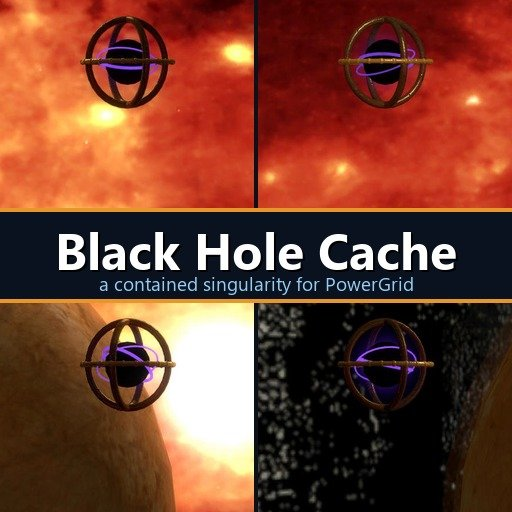
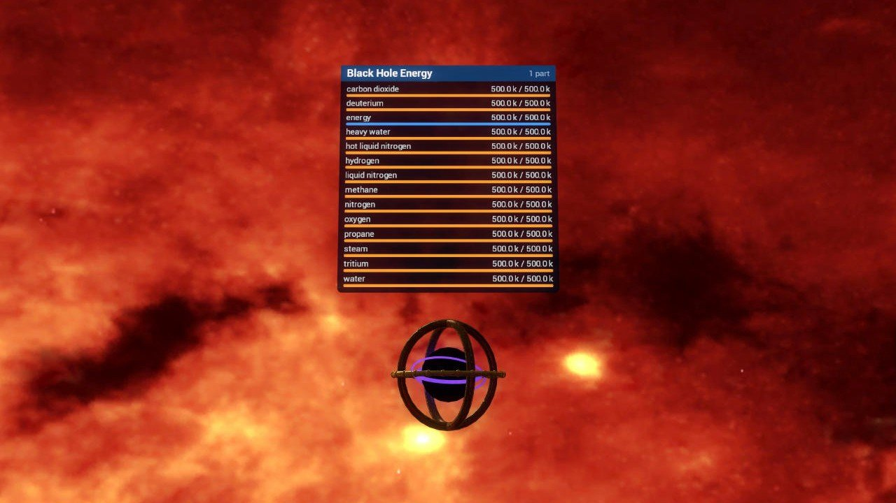
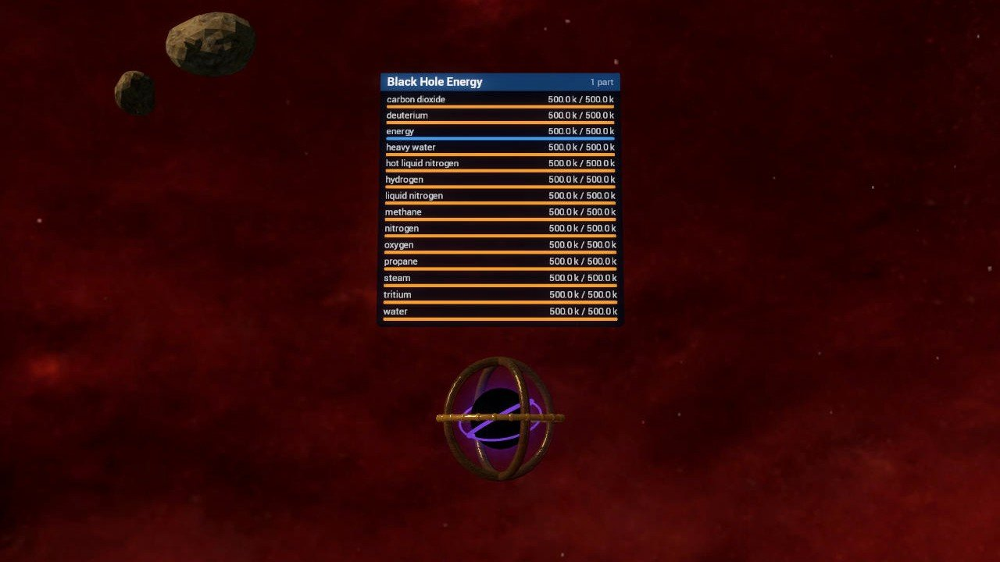
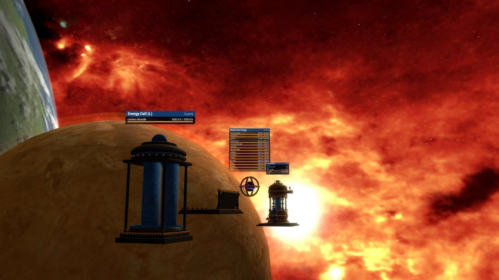
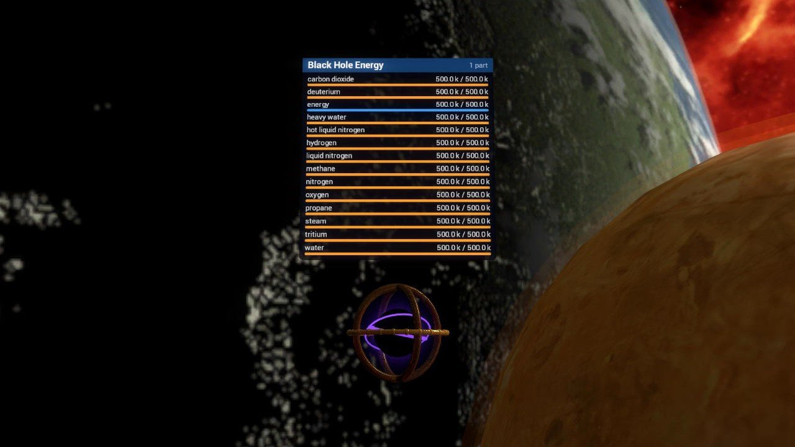
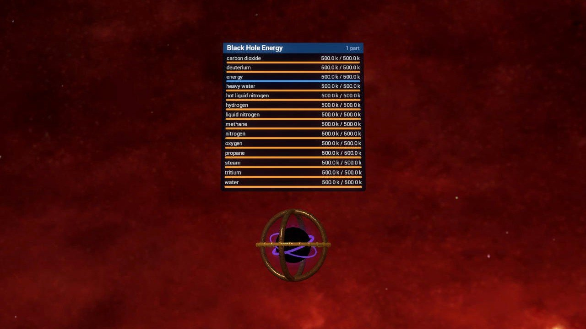
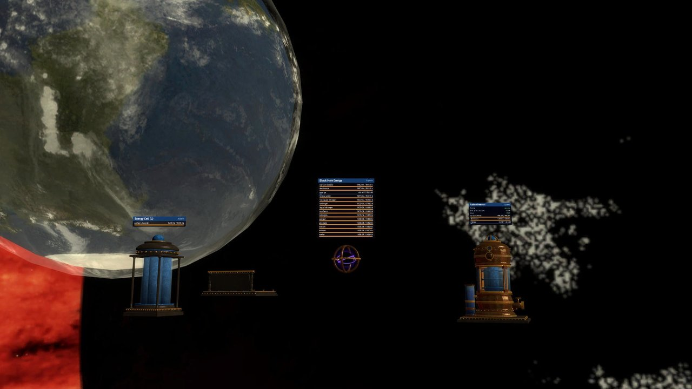

# Black Hole Cache

> A singularity in a jar. It never runs dry, and it never eats your base.

The Black Hole Cache is a contained singularity for PowerGrid. Link it to a network and that network has every resource it will ever need: energy, oxygen, water, nitrogen, hydrogen and the rest. It refills itself, pulls nothing in and destroys nothing.

## Install
**Steam Workshop (easiest):** subscribe [there](https://steamcommunity.com/sharedfiles/filedetails/?id=3840678750).

**By hand:** download `blackhole_cache-1.0.0.zip` from [Releases](../../releases/latest) and unpack it into
`garrysmod/addons/` (you get the folder `garrysmod/addons/blackhole_cache`).

## Bugs, problems and wishes
Please use [Issues](../../issues): pick *Bug report* or *Wish or idea*. On the Steam Workshop page the comments work too.

## Pictures

---

## What it does
- Holds every PowerGrid resource at once, and refills itself
- Link it like any other part: everything on its network is supplied
- A panel above it shows every resource it holds
- Admins only by default, so it stays a tool for builders and events, not a way around the game. Admins can open it to everyone in the PowerGrid settings

Good for: testing a ship without building its power plant first, admin events, build servers where resources should never be the problem.

---

## Required
- **PowerGrid** - Steam lists it under *Required Items*

All Ascension Gates addons in one click: [Ascension Gates - Complete](https://steamcommunity.com/sharedfiles/filedetails/?id=3840681489)

## First steps
1. Q > tools on the right > **PowerGrid Parts** > Black Hole Energy. Place it.
2. Link it to a power node with the **PowerGrid Connector**.
3. Everything on that node now has what it needs.

## Settings
Q > PowerGrid > Settings > **Black Hole Energy**: admins only or everyone. Console: **agp_blackhole_cache_everyone 1**.
Pasting it with the duplicator or AdvDupe2 follows the same rule.

## Privacy
The Black Hole Cache collects nothing and never goes online.

---

## Feed the singularity
> Infinite resources in the game. My coffee supply, sadly, is very finite.

If the cache saved you an hour of building generators, a small tip is welcome:

Never needed, always appreciated. A thumbs-up helps too.

---

## Licence
MIT. Code, model and textures are original work.
